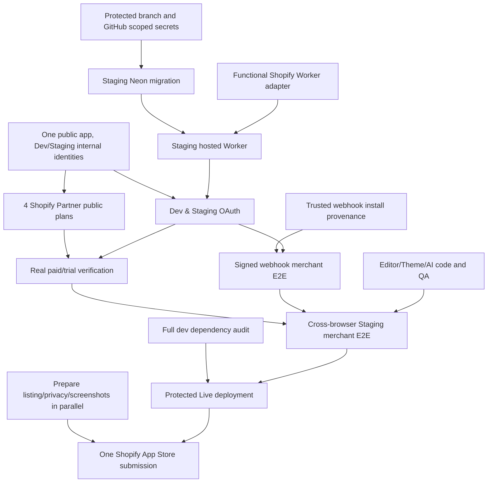

# VSN Builder — Task Dependency Roadmap

**Owner decision: 14 October 2026. This plan schedules by direct task prerequisites, never Phase 1 → 8.**

## Working rules

Tasks with no unmet prerequisites are READY and can proceed from any workstream in parallel. Code preparation and research on WAITING tasks can also proceed when safe; real acceptance is gated only by that task's own dependencies. IN REVIEW means proposed code awaiting integration; VERIFIED applies exclusively to the narrowly described acceptance scope, never to the entire product.

Earlier eight-phase trackers are legacy historical evidence inventories. They do **not** determine the order in which work is scheduled. Keep existing release gates separately fail-closed: real merchant Shopify auth/billing, Neon migrations and recovery, Cloudflare runtime, scoped secrets, audit CI and exact-source approvals.

## Current scope-limited task counts: 41 total

**9 VERIFIED** narrow tasks · **4 IN REVIEW** · **9 READY** · **19 WAITING**. This does not measure overall product readiness or imply production deployment.

One public **VSN | Builder** app; Dev/Staging only internal testing. No Free plan.

| Plan / canonical ID | Monthly USD | Annual USD | Shopify free trial |
| --- | ---: | ---: | ---: |
| Starter / `starter` | $30 | — | 10 days |
| Sliver / `sliver` | $100 | — | 10 days |
| Gold / `gold` | $150 | — | 10 days |
| Platinum / `platinum` | $350 | $3,000 | 10 days |

## READY queue (parallel, ordered by priority)

| ID | Priority | Startable task | Issue |
| --- | --- | --- | --- |
| `T011` | P0 | Resolve mandatory full-dev dependency security audit (braces) | [#96](https://github.com/Vertex-Systems-Network/vsn-builder/issues/96) |
| `T012` | P0 | Review/rebase/merge stacked PRs with mandatory exact-SHA CI | [#157](https://github.com/Vertex-Systems-Network/vsn-builder/issues/157) |
| `T013` | P0 | Protect development branch and verify GitHub required reviewers | [#158](https://github.com/Vertex-Systems-Network/vsn-builder/issues/158) |
| `T014` | P0 | Configure/verify GitHub Environment secrets and tier variables | [#158](https://github.com/Vertex-Systems-Network/vsn-builder/issues/158) |
| `T015` | P0 | Verify single public Shopify Builder app and internal Dev/Staging identities | [#159](https://github.com/Vertex-Systems-Network/vsn-builder/issues/159) |
| `T020` | P0 | Implement functional hosted React Router/Shopify Worker adapter | [#161](https://github.com/Vertex-Systems-Network/vsn-builder/issues/161) |
| `T024` | P0 | Trusted uninstall-generation provenance and safe replay handling | [#163](https://github.com/Vertex-Systems-Network/vsn-builder/issues/163) |
| `T032` | P1 | Templates/Widgets/theme app assets implementation and synthetic QA | [#165](https://github.com/Vertex-Systems-Network/vsn-builder/issues/165) |
| `T040` | P1 | Shopify listing screenshots, privacy, support, scopes and review assets | [#168](https://github.com/Vertex-Systems-Network/vsn-builder/issues/168) |

## Dependency graph (high-level)

## All 41 atomic tasks

| ID | Workstream | Priority | Task | Depends on | Computed status | Issue |
| --- | --- | --- | --- | --- | --- | --- |
| `T001` | Infrastructure | P0 | Environment isolation and fail-closed config templates | None | VERIFIED (scope-limited) | [#94](https://github.com/Vertex-Systems-Network/vsn-builder/issues/94) |
| `T002` | Local QA | P0 | Local SQLite migration and synthetic desktop/mobile browser acceptance | None | VERIFIED (scope-limited) | [#114](https://github.com/Vertex-Systems-Network/vsn-builder/issues/114) |
| `T003` | Database | P0 | PostgreSQL schema parity, disposable SQL CRUD/rollback | None | VERIFIED (scope-limited) | [#141](https://github.com/Vertex-Systems-Network/vsn-builder/issues/141) |
| `T004` | Runtime | P0 | Local Workerd SDK/Prisma SSR and Wrangler dry-run compile | None | VERIFIED (scope-limited) | [#155](https://github.com/Vertex-Systems-Network/vsn-builder/issues/155) |
| `T005` | Database | P0 | Neon Staging shadow-branch SQL migration/savepoint rollback | None | VERIFIED (scope-limited) | [#160](https://github.com/Vertex-Systems-Network/vsn-builder/issues/160) |
| `T006` | Database | P0 | Staging pre-migration root snapshot and empty-baseline restore | None | VERIFIED (scope-limited) | [#160](https://github.com/Vertex-Systems-Network/vsn-builder/issues/160) |
| `T007` | Shopify Auth | P0 | Shopify official SDK synthetic session and tenant gate | None | VERIFIED (scope-limited) | [#162](https://github.com/Vertex-Systems-Network/vsn-builder/issues/162) |
| `T008` | Security | P0 | Webhook HMAC and transactional mutation synthetic security | None | VERIFIED (scope-limited) | [#163](https://github.com/Vertex-Systems-Network/vsn-builder/issues/163) |
| `T009` | Merchant Features | P1 | Internal editor/components/AI QA scripts | None | VERIFIED (scope-limited) | [#165](https://github.com/Vertex-Systems-Network/vsn-builder/issues/165) |
| `T010` | Engineering Planning | P0 | Adopt dependency-based task board, validator, issue mapping | None | IN REVIEW | [#156](https://github.com/Vertex-Systems-Network/vsn-builder/issues/156) |
| `T011` | Security | P0 | Resolve mandatory full-dev dependency security audit (braces) | None | READY | [#96](https://github.com/Vertex-Systems-Network/vsn-builder/issues/96) |
| `T012` | Integration | P0 | Review/rebase/merge stacked PRs with mandatory exact-SHA CI | None | READY | [#157](https://github.com/Vertex-Systems-Network/vsn-builder/issues/157) |
| `T013` | Infrastructure | P0 | Protect development branch and verify GitHub required reviewers | None | READY | [#158](https://github.com/Vertex-Systems-Network/vsn-builder/issues/158) |
| `T014` | Infrastructure | P0 | Configure/verify GitHub Environment secrets and tier variables | None | READY | [#158](https://github.com/Vertex-Systems-Network/vsn-builder/issues/158) |
| `T015` | Shopify Auth | P0 | Verify single public Shopify Builder app and internal Dev/Staging identities | None | READY | [#159](https://github.com/Vertex-Systems-Network/vsn-builder/issues/159) |
| `T016` | Database | P0 | Real Neon Staging pooled/direct credentials and connectivity | `T014` | WAITING | [#160](https://github.com/Vertex-Systems-Network/vsn-builder/issues/160) |
| `T017` | Database | P0 | Live Neon snapshot/default/compute attestation in protected preflight | `T006` | IN REVIEW | [#160](https://github.com/Vertex-Systems-Network/vsn-builder/issues/160) |
| `T018` | Database | P0 | Protected Staging Prisma migrate deploy and data restore drill | `T011`, `T012`, `T013`, `T014`, `T016`, `T017` | WAITING | [#160](https://github.com/Vertex-Systems-Network/vsn-builder/issues/160) |
| `T019` | Runtime | P0 | Bind and verify real Cloudflare Staging secrets and tier variables | `T014`, `T015`, `T016` | WAITING | [#161](https://github.com/Vertex-Systems-Network/vsn-builder/issues/161) |
| `T020` | Runtime | P0 | Implement functional hosted React Router/Shopify Worker adapter | `T004` | READY | [#161](https://github.com/Vertex-Systems-Network/vsn-builder/issues/161) |
| `T021` | Runtime | P0 | Staging Worker deploy and stable HTTPS callback acceptance | `T011`, `T012`, `T013`, `T018`, `T019`, `T020` | WAITING | [#161](https://github.com/Vertex-Systems-Network/vsn-builder/issues/161) |
| `T022` | Shopify Auth | P0 | Real Dev Shopify test-store install, OAuth and session acceptance | `T002`, `T015` | WAITING | [#162](https://github.com/Vertex-Systems-Network/vsn-builder/issues/162) |
| `T023` | Shopify Auth | P0 | Real Staging Shopify OAuth, App Bridge ID token and session lifecycle | `T015`, `T021`, `T022` | WAITING | [#162](https://github.com/Vertex-Systems-Network/vsn-builder/issues/162) |
| `T024` | Security | P0 | Trusted uninstall-generation provenance and safe replay handling | `T008` | READY | [#163](https://github.com/Vertex-Systems-Network/vsn-builder/issues/163) |
| `T025` | Security | P0 | Real signed Shopify webhook retry/uninstall/reinstall E2E | `T018`, `T023`, `T024` | WAITING | [#163](https://github.com/Vertex-Systems-Network/vsn-builder/issues/163) |
| `T026` | Security | P0 | Enforce paid-tier authorization across every server-side merchant mutation | `T007` | IN REVIEW | [#164](https://github.com/Vertex-Systems-Network/vsn-builder/issues/164) |
| `T027` | Billing | P0 | Review and integrate exact four-plan pricing code PR #153 | None | IN REVIEW | [#164](https://github.com/Vertex-Systems-Network/vsn-builder/issues/164) |
| `T028` | Billing | P0 | Create/verify exactly four public plans in Shopify Partner Dashboard | `T015` | WAITING | [#164](https://github.com/Vertex-Systems-Network/vsn-builder/issues/164) |
| `T029` | Billing | P0 | Real subscription/trial lifecycle and plan limits E2E | `T023`, `T026`, `T027`, `T028` | WAITING | [#164](https://github.com/Vertex-Systems-Network/vsn-builder/issues/164) |
| `T030` | Merchant Features | P1 | Real Dev create/edit/save/preview and reload persistence | `T022` | WAITING | [#165](https://github.com/Vertex-Systems-Network/vsn-builder/issues/165) |
| `T031` | Merchant Features | P1 | Real Staging create/edit/save/publish Shopify page persistence | `T018`, `T023`, `T026`, `T030` | WAITING | [#165](https://github.com/Vertex-Systems-Network/vsn-builder/issues/165) |
| `T032` | Merchant Features | P1 | Templates/Widgets/theme app assets implementation and synthetic QA | `T009` | READY | [#165](https://github.com/Vertex-Systems-Network/vsn-builder/issues/165) |
| `T033` | Merchant Features | P1 | Real Shopify theme extension storefront/mobile E2E | `T031`, `T032` | WAITING | [#165](https://github.com/Vertex-Systems-Network/vsn-builder/issues/165) |
| `T034` | Merchant Features | P1 | AI/widgets/pages/seats quotas across Starter-Sliver-Gold-Platinum | `T026`, `T027`, `T031` | WAITING | [#165](https://github.com/Vertex-Systems-Network/vsn-builder/issues/165) |
| `T035` | Merchant QA | P1 | Full Staging test-store browser/device/billing/webhook E2E | `T025`, `T029`, `T033`, `T034` | WAITING | [#166](https://github.com/Vertex-Systems-Network/vsn-builder/issues/166) |
| `T036` | Merchant QA | P0 | Staging deployment rollback and post-migration restore acceptance | `T018`, `T021`, `T035` | WAITING | [#166](https://github.com/Vertex-Systems-Network/vsn-builder/issues/166) |
| `T037` | Production Release | P0 | Production Neon isolated migration, backup and recovery proof | `T011`, `T012`, `T013`, `T014`, `T035`, `T036` | WAITING | [#167](https://github.com/Vertex-Systems-Network/vsn-builder/issues/167) |
| `T038` | Production Release | P0 | Authorized production Worker/promoted exact SHA and secrets | `T011`, `T012`, `T014`, `T020`, `T036`, `T037` | WAITING | [#167](https://github.com/Vertex-Systems-Network/vsn-builder/issues/167) |
| `T039` | Production Release | P0 | Live merchant smoke, safety rollback and payment verification | `T029`, `T038` | WAITING | [#167](https://github.com/Vertex-Systems-Network/vsn-builder/issues/167) |
| `T040` | App Store Review | P1 | Shopify listing screenshots, privacy, support, scopes and review assets | None | READY | [#168](https://github.com/Vertex-Systems-Network/vsn-builder/issues/168) |
| `T041` | App Store Review | P0 | Attempt Shopify App Store submission only after release certification | `T011`, `T025`, `T029`, `T035`, `T039`, `T040` | WAITING | [#168](https://github.com/Vertex-Systems-Network/vsn-builder/issues/168) |

**In-review update:** T026 server-side paid merchant mutation guards now have [Draft PR #170](https://github.com/Vertex-Systems-Network/vsn-builder/pull/170) with 30 protected action routes and synthetic tests. This is code in review, NOT verified merchant acceptance or a release authorization.

## Current external blockers

- Mandatory full dev dependency audit #96 is red for the `braces` advisory. Production-only audit passing is NOT an exception.
- Cloudflare Staging and Production Worker records exist but each has **0 real secret bindings and 0 settings bindings**.
- Neon Staging QA shadow migration succeeded in isolation, but default Staging and Production have **0 application tables** and real protected Prisma migrations have not run.
- `development` GitHub branch was last observed unprotected; tier-scoped secrets, reviewers and real identities remain externally unverified.
- PR #153 paid plan code and PR #155 hosted Worker/Neon code are still draft/unmerged. A PR or synthetic test is NOT real merchant acceptance.

## Commands / status discipline

Use `node scripts/task-dependency-check.mjs` for READY tasks, `node scripts/task-dependency-check.mjs --format=markdown` for a full table and `node --test tests/task-dependency-check.test.mjs` for graph/policy regression. A release must separately pass security/Shopify/hosted gates. `--require-verified=T041` fails until actual Shopify submission has evidence, not merely a plan.

## Existing work references

- [Master dependency board #156](https://github.com/Vertex-Systems-Network/vsn-builder/issues/156)
- [Security audit #96](https://github.com/Vertex-Systems-Network/vsn-builder/issues/96)
- [Hosted runtime umbrella #95](https://github.com/Vertex-Systems-Network/vsn-builder/issues/95)
- [Shopify pricing/submission umbrella #154](https://github.com/Vertex-Systems-Network/vsn-builder/issues/154)
- [Neon/Cloudflare PR #155](https://github.com/Vertex-Systems-Network/vsn-builder/pull/155)
- [Four paid tiers PR #153](https://github.com/Vertex-Systems-Network/vsn-builder/pull/153)
